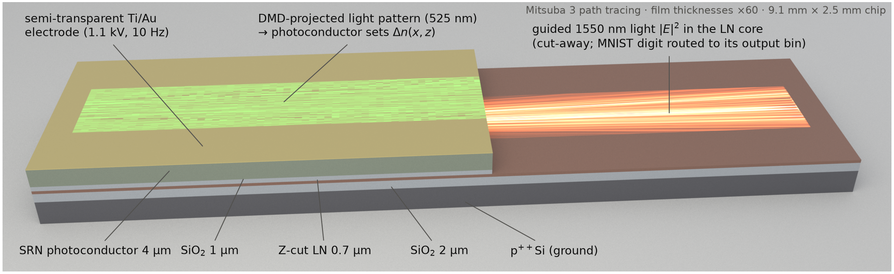
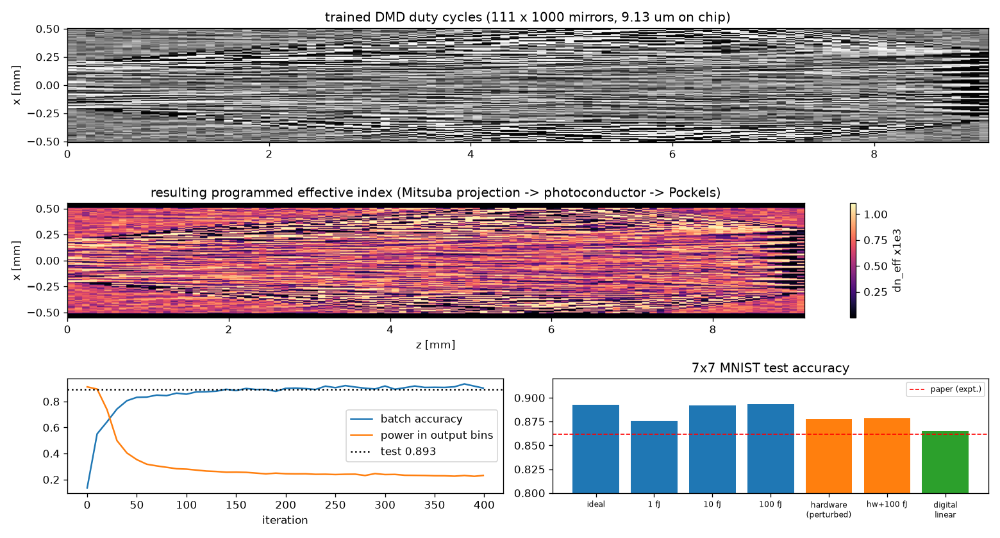
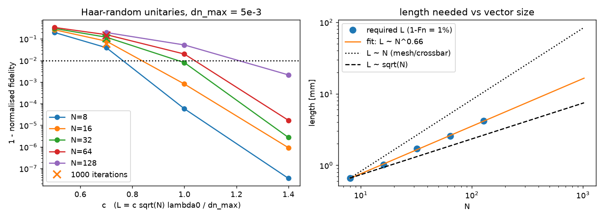
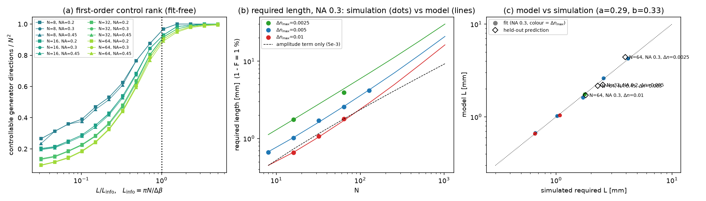
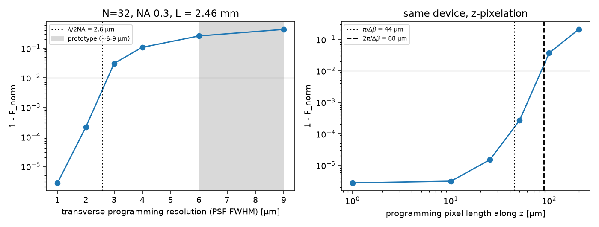
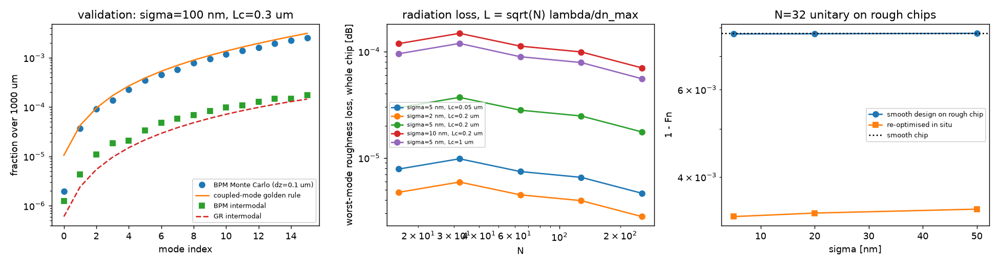
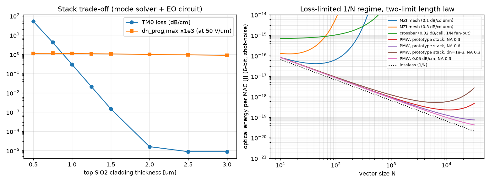
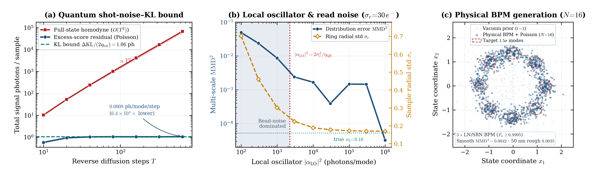
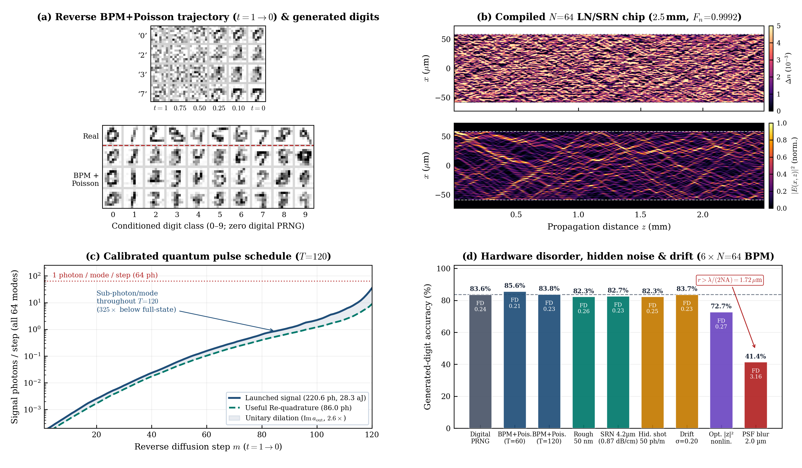

# pwg-sim — physical simulation of a 2D-programmable multimode waveguide

A differentiable, physics-first simulation of the programmable-waveguide
processor of **Onodera, Stein, …, Wright & McMahon**, *"Scaling on-chip photonic
neural processors using arbitrarily programmable wave propagation"*
([arXiv:2402.17750](https://arxiv.org/abs/2402.17750); Nature Physics version
*"Arbitrary control over multimode wave propagation for machine learning"*),
written in **Dr.Jit** (wave propagation, adjoints, EO model) and **Mitsuba 3**
(DMD projection optics).

The goal is to test, from first-principles wave-optics and electro-optics
simulations, the core scaling properties of programmable multimode waveguides:

* whether propagation length scales as **L ∝ √N** rather than L ∝ N
  (as in MZI meshes and crossbars);
* whether eliminating single-mode bends and high-contrast etched sidewalls keeps
  propagation loss low enough to sustain the coherent **1/N energy regime** to
  N ≳ 1k–10k;
* whether a ~1 cm waveguide suffices for 1k × 1k operations at well under
  1 dB total loss;
* how quantum shot noise compares against deterministic hardware imperfections.

Every number below comes from the code in this repo (`results/`, `figures/`).
Paper values are given for comparison.

### Summary of findings (details below)

| physical question | simulation finding |
|---|---|
| L ∝ √N instead of N | **Only up to a crossover.** L = a·f(N)·√N·λ/Δn_max + b·πN/Δβ: an amplitude bound scaling as √(N ln N) *plus* a modal-bandwidth (degree-of-freedom) bound ∝ N·nλ/NA², with f(N) = √(1.5 ln N). The measured N^0.66 (N = 8–128, NA 0.3) sits in the crossover between them. √N dominates up to N ≈ 10³ only for NA ≳ 0.6 (the paper's regime); at fixed NA, L → ∝ N asymptotically. |
| ~1 cm for 1k × 1k | 1.2 cm at NA 0.6 (matches the paper's 11 mm), 2.1 cm at NA 0.3 (Δn_max = 5e-3). |
| < 0.5 dB loss for the whole chip at 1k | 0.36 dB (NA 0.6, 1.2 cm) or 0.62 dB (NA 0.3, 2.1 cm) with the prototype stack's 0.30 dB/cm leakage. A 2 µm top oxide cuts that to ~0 at 90 % of Δn_max. |
| low loss without single-mode bends or high-contrast etched edges | Confirmed. With the physical shallow-etch walls, roughness of σ = 5–10 nm costs < 10⁻⁴ dB per chip and *decreases* with N. The same roughness on a high-contrast single-mode wire costs 0.4–33 dB/cm. A designed unitary survives σ = 50 nm unchanged. |
| 1/N energy regime beyond 1k, toward 10k | Yes: about 10⁴ at NA 0.3, beyond 3·10⁴ at NA 0.6 (Δn_max = 5e-3); about 6k with today's Δn ≈ 1e-3. MZI meshes stop at N ≈ 15–45. Programming resolution must keep up (Δx ≲ λ/2NA). |
| shot noise vs. hardware imperfections | Built in. On feedforward 7×7 MNIST the accuracy is unchanged down to 10 fJ per inference and drops 1.7 points at 1 fJ, comparable to a 1.5-point drop from uncalibrated hardware mismatch. |



*Mitsuba 3 path-traced render of the simulated chip: the trained DMD pattern
(green) programs the photoconductor, and the cut-away shows the simulated
1550 nm guided intensity for an MNIST digit in the LN core (film thicknesses ×60).*

Publication figures (vector PDF + 300 dpi PNG) are in `figures/pub/`, built by
`experiments/pub_figures.py`:
- [light propagation](figures/pub/fig_light_propagation.png)
- [DMD projection optics and programming chain](figures/pub/fig_projection_optics.png)
- [stack and mode profiles](figures/pub/fig_stack_modes.png)

---

## What is modelled

```
DMD duty cycles ─(Mitsuba thin-lens projection, defocus, Airy blur)─► irradiance I(x,z)
  ─(Si-rich-SiN photoconductor + series-impedance AC circuit + Pockels r33)─► Δn_LN
  ─(2D electro-quasistatic fringing LSF)─► Δn_eff(x,z) = Γ·Δn_LN
  ─(split-step BPM of the TM0 slab mode, exact non-paraxial propagator)─► output field
  ─(camera bins, Poisson shot noise + read noise)─► measured outputs
```

| module | physics |
|---|---|
| `pwg/stack.py` | Anisotropic leaky TM/TE slab mode solver (FD, PML) for the real stack: p⁺⁺Si / 2 µm SiO₂ / 0.7 µm Z-cut MgO:LN / 1 µm SiO₂ / 4 µm SRN / Ti/Au. Gives n_eff, leakage loss (tunnelling into the high-index SRN, absorbed by the electrode; Si substrate leakage is negligible), and the EO overlap Γ = ∂n_eff/∂n_e. |
| `pwg/electro.py` | Photoconductive EO programming: four-layer series AC impedance with σ_SRN(I) = σ_d + σ_ph (I/I_ref)^γ, calibrated to the paper's measured dark/bright Δn. Also a 2D (x,y) finite-difference solve of ∇·((σ+iωε₀ε)∇φ)=0 with anisotropic LN permittivity, giving the lateral line-spread function. |
| `pwg/projector.py` | Mitsuba 3 scene: DMD (13.7 µm mirrors) as a textured area emitter imaged by a `thinlens` sensor with the projection NA, 1.5× demagnification and focus error. Rendering is differentiable (`prb`), so gradients reach the mirror duty cycles. |
| `pwg/fft.py` | Radix-2 Stockham FFT in pure Dr.Jit (one gather kernel per stage, batched). |
| `pwg/bpm.py` | Split-step Fourier BPM, exact `sqrt(k²−kx²)` propagator, absorbing boundaries, loss. Wrapped as a `dr.CustomOp` whose backward pass is the exact discrete adjoint with √-checkpointing (verified against finite differences). |
| `pwg/device.py` | The prototype: 111 × 1000 mirrors (1.0 × 9.1 mm), 49 Gaussian inputs (w₀ = 6 µm, 8.2 µm pitch), 10 camera bins. |
| `pwg/lateral.py` | Physically derived lateral confinement for the scaled multimode device: a shallow partial etch of the LN film with a sloped sidewall. Uses local slab solves n_eff(t_LN), sub-pixel ε-averaging onto the grid, and is validated against a full 2D cross-section eigen-solve. |
| `pwg/mmwg.py` | Programmable multimode waveguide (PMW): N guided modes as the vector basis, computed as exact eigenvectors of the discrete BPM step operator. Δn ∈ [0, Δn_max] programmed in the core. |
| `pwg/roughness.py` | Sidewall roughness: Ornstein–Uhlenbeck edge processes (exponential ACF), explicit in the BPM, plus coupled-mode / Fermi-golden-rule radiation, intermodal and backscatter rates. |
| `pwg/noise.py` | Shot noise, read noise and RIN. |
| `pwg/diffusion.py` | Shot-noise-driven photonic denoising diffusion: VP-SDE in excess-score ($v$-prediction) coordinates, exact dual-photodiode Poisson balanced-homodyne detection, Cayley unitary score networks (`UnitaryScoreNet`), and physical BPM waveguide compilation. |

## Results

### 1. Device physics vs. the paper (`tests/test_physics.py`)

| quantity | this model | paper |
|---|---|---|
| TM0 effective index | 1.950 | 1.94 |
| TM0 loss (SRN cavity + electrode absorption) | 0.30 dB/cm | 0.23 dB/cm (COMSOL), < 1 dB/cm measured |
| EO overlap Γ = ∂n_eff/∂n_e | 0.846 | – |
| Δn_LN dark / bright (1100 V, 10 Hz, 50 mW/cm²) | 4.0e-3 / 5.2e-3 (calibration targets) | 4.0e-3 / 5.2e-3 |
| fitted SRN conductivity σ_d / σ_ph | 1.35e-9 / 4.56e-9 S/m (γ = 0.8 assumed) | – |
| programmable Δn_eff, 1100 V, 10 Hz | 1.1e-3 | ~1.0–1.2e-3 |
| electrostatic resolution (edge LSF FWHM) | 2.6 µm | ~3.5 µm |
| Mitsuba defocus blur, 50 µm focus error, NA 0.1 | 9.1 µm (10–90%) | – (geometric: 2·NA·δ = 10 µm) |

**Where the 0.30 dB/cm comes from.** TM0 (n_eff 1.950) tunnels through the
1 µm top oxide into the SRN (n = 2.03 > n_eff). The 4 µm SRN layer, capped by
the Ti/Au electrode, behaves as a lossy Fabry–Pérot cavity, and the metal
absorbs the light. Removing the metal *and* SRN absorption gives 0 dB/cm.
Replacing the Si substrate by oxide changes nothing, and SRN bulk absorption
contributes < 0.001 dB/cm. Because the loss sits on a cavity resonance it is
very sensitive: SRN thickness 3.9 / 4.0 / 4.1 µm gives 0.14 / 0.30 / 0.49 dB/cm,
and an alternative Au dataset gives 0.27 dB/cm. The paper's COMSOL value
(0.23) lies inside this uncertainty. Nothing was fitted to it.

**Known discrepancy.** A single-pole RC photoconductor model predicts the
programmable Δn falls to about 0.3e-3 at 26 Hz / 1000 V, whereas the paper
operated its ML experiments there with Δn_max ≈ 0.8e-3. The likely cause is
frequency-dependent hopping conductivity in amorphous SRN (σ_ac ∝ ω^s), which
is not modelled. The ML experiments below therefore use the 10 Hz / 1100 V
operating point.

### 2. Prototype: 7×7 MNIST end-to-end through the physics (`experiments/mnist_prototype.py`)



49 inputs, 10 output bins and 11,100 programmable macropixels (9 µm × 91 µm,
about the paper's 10⁴). Trained end-to-end through Mitsuba → photoconductor →
BPM in about 14 minutes.

| | test accuracy (5k images) |
|---|---|
| ideal model | **89.3 %** |
| + shot noise at 1 / 10 / 100 fJ per inference | 87.6 / 89.2 / 89.3 % |
| "hardware" (+15 µm defocus, −2 % voltage, 4.2 µm SRN with nominal σ, 8-bit DMD, new Monte Carlo seed) | 87.8 % |
| paper, experiment | 86.2 % |
| digital linear classifier, same 49 features | 86.5 % |

The thicker photoconductor raises the TM0 leakage loss from 0.30 to
0.87 dB/cm, which illustrates how sensitive the leaky SRN coupling is. Shot
noise only matters at about 1 fJ per inference, i.e. about 8,000 photons
spread over 10 outputs.

### 3. Lateral confinement derived from physics, not smoothed (`pwg/lateral.py`)

The scaled-up device confines light laterally with a partial etch of the LN
film (planarised top oxide). NA = 0.3 requires an etch of **49.7 nm**. The
sidewall is sloped at 70°, so the transition is 18 nm wide, far below the
0.5 µm grid. It enters the BPM only through sub-pixel ε-averaging. The etched
region leaks less (0.09 dB/cm) than the core (0.30 dB/cm), so mode-dependent
loss follows from each mode's overlap.

* **Effective-index validation:** the lateral-mode spacings of the reduced 1D
  model agree with a full 2D (x,y) cross-section eigen-solve to < 0.5 %.
* **Numerical convergence:** with this sharp edge, split-step leakage is
  0.46 dB/cm at dz = 2 µm and 0.001 dB/cm at dz = 1 µm, so dz = 1 µm is used.
  Mode propagation constants are converged to < 0.01 rad over 700 µm.
  A designed unitary re-simulated at dz/2 reproduces its matrix (F_norm > 0.99).
* The guided modes are computed as exact eigenvectors of the discrete Strang
  step operator, so unprogrammed propagation is diagonal to machine precision.

### 4. Length scaling: L ∝ √N (`experiments/unitary_scaling.py`)



Inverse design of Haar-random N×N unitaries between the guided modes of the
etched multimode guide (NA 0.3, Δn ∈ [0, 5e-3] as in the paper's Fig. 5,
1 µm programming resolution, dz = 1 µm, 300 Adam iterations,
global-phase-invariant field loss). The length is swept as
L = c·√N·λ₀/Δn_max. The *normalised fidelity* F_n = |Tr(U†T)|/(√N‖T‖) is
used, with global transmission (0.3 dB/cm loss) reported separately.

| N | width | c needed for 1−F_n = 1 % | required L |
|---|---|---|---|
| 8 | 31 µm | 0.75 | 0.66 mm |
| 16 | 52 µm | 0.82 | 1.02 mm |
| 32 | 93 µm | 0.97 | 1.70 mm |
| 64 | 176 µm | 1.03 | 2.56 mm |
| 128 | 341 µm | 1.19 | 4.17 mm |

**Power-law fit: L ∝ N^0.66.** This is much better than the L ∝ N of MZI
meshes and crossbars, but measurably steeper than √N. The excess is not an
optimiser artefact: 1000 instead of 300 iterations at c = 0.7 improves F_n only
from 0.922 → 0.941 (N = 16), 0.881 → 0.896 (N = 32) and 0.844 → 0.857 (N = 64)
(× markers in the plot). Section 4b explains it.

### 4b. Why N^0.66: amplitude and modal-bandwidth bounds (`experiments/scaling_explained.py`, `pwg/controllability.py`)



Building a unitary by programmed propagation is a coupled-mode control problem
(the modes are the levels, z is the propagation parameter, k₀Δn(x,z) is the
control). It is subject to two independent lower bounds on propagation length:

1. **Modulation-amplitude bound (Mandelstam–Tamm-type) — √N scaling.** The generator
   −i·logm(U) of a Haar unitary has Frobenius norm π√(N/3). First-order
   coupled-mode theory gives rms(Δn) = ‖A‖_F/(k₀L), so L_amp ∝ √N λ/Δn_max.
   The linear controllability model (`pwg/controllability.py`) reproduces this
   coefficient exactly in the long-L limit.
2. **Modal-bandwidth / degree-of-freedom bound (Lloyd & Montangero, PRL 113, 010502 (2014)).**
   A target with D = N² real parameters needs at least D independent controls.
   The programmed Δn(x,z) reaches the generator only through its Fourier
   components inside the coupling band. Transversely that is about 2N
   independent profiles (|q_x| ≤ 2k₀NA). Longitudinally it is about Δβ·L/π
   resolvable beat frequencies, where Δβ ≈ k₀NA²/2n is the spread of the
   modes' propagation constants. So L_info = πN/Δβ ≈ N·nλ/NA². Equivalently,
   L must exceed the adjacent-mode beat length at the top of the mode
   spectrum. This bound does not depend on Δn_max at all.

**Evidence.**

* **(a) Fit-free counting.** The number of generator directions controllable
  at first order (eigenvalues of the N²×N² Gram matrix above 10 % of the
  mean) depends only on L/L_info for N = 8…64 and NA = 0.2/0.3/0.45. It
  saturates at N² at L ≈ L_info. The first-order map is pessimistic in
  absolute terms: the hardest directions are couplings among low-order,
  nearly degenerate modes, whose *imaginary* part can only be produced at
  second order (commutators), which the nonlinear optimiser exploits. So the
  counting fixes the *form*, and the prefactor is fitted.
* **Δn-independent offset.** At fixed N the required length is exactly linear
  in 1/Δn_max with an offset. For N = 16 the three Δn values give
  L = 3.70 µm/Δn + 288 µm, which reproduces the middle point to 1 %. The offsets
  for N = 16 and N = 32 are both 0.32·L_info. Doubling Δn_max therefore
  shortens N = 16 by only 1.54× (pure √N limit: 2×).
* **(b, c) One law for everything.**

  L = a·√(1.5 ln N)·√N·λ/Δn_max + b·πN/Δβ(N)

  Here Δβ(N) comes from the mode solver and tends to k₀NA²/2n. Fitted on all
  NA = 0.3 runs (N = 8–128 at Δn = 5e-3, plus N = 16/32 at 2.5e-3 and 1e-2),
  the law has 2.3 % rms error with a = 0.29 and b = 0.33. Without the
  √(ln N) factor the error is 7.9 %.

  The √(ln N) factor is consistent with the peak-to-rms (extreme-value) factor
  of a programmed pattern over M ∝ W·L ∝ N^{3/2} resolution cells. The pattern
  must fit in [0, Δn_max] while its rms grows as √N/L. This is an
  interpretation, not a derivation.
* **Predictions (not in the fit).**
  All four were recorded before the runs that settle them finished
  (`results/prediction_*.json`):

  | held-out point | predicted L | simulated L | error |
  |---|---|---|---|
  | NA 0.45, N = 64 | 2.16 mm | 2.29 mm | −6 % |
  | NA 0.2, N = 32 | 2.21 mm | 2.53 mm | −12 % |
  | Δn_max 1e-2, N = 64 | 1.71 mm | 1.79 mm | −4 % |
  | Δn_max 2.5e-3, N = 64 | 4.41 mm | 3.94 mm | +12 % |

**Consequences.**
* With the fitted constants the two terms are equal at **N* ≈ 640** (NA 0.3,
  Δn_max = 5e-3). The measured exponent of 0.66 over N = 8–128 combines two
  effects:
  * the slowly growing amplitude prefactor: √(N ln N) has a local exponent of
    about 0.62 at N = 64;
  * the onset of the Δn-independent bandwidth term, already 35 % of L at
    N = 128.
* At fixed NA, L → ∝ N asymptotically, the same scaling as meshes, just with a
  small prefactor nλ/NA².
* The √N regime extends only while the bandwidth term is subdominant, which
  needs high lateral NA:

  | N | NA 0.3 | NA 0.6 (paper's regime) |
  |---|---|---|
  | 1,000 | 20.5 mm | **11.9 mm** (paper: 11 mm) |
  | 10,000 | 146 mm | 61 mm |

  High NA means high lateral index contrast, which raises sidewall-roughness
  scattering ∝ Δn_lateral² (section 5D). So NA is the real design trade-off,
  not loss alone.

### 4c. Programming resolution



N = 32, NA 0.3, L = 2.46 mm (c = 1.4, F_n = 0.999997 at 1 µm resolution).

* **Transverse.** The PSF of the programmed index (Gaussian, FWHM r) crosses
  1 % infidelity at **r ≈ 2.7 µm ≈ λ/(2NA) = 2.6 µm**, one period of the
  highest transverse coupling frequency 2k₀NA. Values: 1, 2, 3, 4, 6, 9 µm
  give 1−F_n = 3e-6, 2e-4, 3e-2, 0.11, 0.26, 0.43.
* **Along propagation.** Block pixels of length p_z cross 1 % at
  **p_z ≈ 83 µm ≈ 2π/Δβ = 88 µm**, one period of the fastest intermodal beat.
  Values: 10, 25, 50, 100, 200 µm give 3e-6, 1.5e-5, 2.6e-4, 3.7e-2, 0.21.

So the programming must resolve one period of the highest coupling frequency
in each direction: Δx ≲ λ/2NA and Δz ≲ 2π/Δβ ≈ 2nλ/NA². The requirement is
strongly anisotropic: sub-3 µm across, but ~100 µm along z, consistent with the
paper's 9 µm × 100 µm macropixels at the prototype's much lower NA. Together
with 4b this gives a hard link: a resolution r caps the usable NA at about
λ/2r, so the bandwidth term becomes ≈ 4b·n·N·r²/λ. For N = 1000 that is
1.7 mm at r = 1 µm, but **≈ 6 cm at the prototype's r ≈ 6 µm**. Programming
resolution, not loss, is the main lever between today's prototype and
1k × 1k.

### 5. Sidewall roughness (`pwg/roughness.py`, `experiments/roughness.py`)



Each wall has an independent Ornstein–Uhlenbeck displacement process
(exponential ACF, rms σ, correlation length L_c), applied to the physical edge
geometry every BPM step. Sub-pixel ε-averaging represents nm displacements
exactly on a 0.5 µm grid.

**A. Validation (σ = 100 nm, L_c = 0.3 µm, N = 16, 1 mm, dz = 0.1 µm, 8 chips).**
Radiation loss from the explicit-roughness BPM Monte Carlo matches the
independent coupled-mode / Fermi-golden-rule rates within 10–20 % (the golden
rule is slightly conservative), including the ∝ m² growth with mode order.
Intermodal scattering is 1.2–2× higher in the BPM than at first order. It is
small and not yet explained: possibly higher-order or finite-length
(non-Markovian) terms.

**B. Realistic roughness, chip length L = √N λ/Δn_max (golden rule).**

| N | L | worst-mode roughness loss of the *whole chip* (σ = 5 nm, L_c = 0.2 µm) | σ = 10 nm |
|---|---|---|---|
| 16 | 1.2 mm | 3.0e-5 dB | 1.2e-4 dB |
| 64 | 2.5 mm | 2.8e-5 dB | 1.1e-4 dB |
| 256 | 5.0 mm | 1.8e-5 dB | 7.0e-5 dB |

Roughness loss *falls* with N. Wider guides put less of each mode's power at
the walls: α ∝ (mode amplitude at wall)², which decreases faster than L grows.
Backscatter is a further 10²–10³× smaller.

**D. Same physics for a single-mode wire** (σ = 5 nm, L_c = 0.2 µm), varying
the lateral contrast:

| lateral Δn_eff | single-mode width | roughness loss |
|---|---|---|
| 0.023 (this PMW's walls) | 2.3 µm | 0.010 dB/cm |
| 0.1 | 1.1 µm | 0.37 dB/cm |
| 0.3 | 0.67 µm | 5.2 dB/cm |
| 0.6 | 0.50 µm | 33 dB/cm |

High-contrast single-mode wires, which MZI meshes and crossbars need for
compact bends and couplers, scatter 10²–10⁴× more per cm than the PMW's
average mode.

**C. Device impact.** A Haar-random N = 32 unitary designed on the smooth
guide (F_norm = 0.9922) keeps F_norm = 0.9922 on rough chips with
σ = 5, 20 and even 50 nm. Roughness is static, so whatever crosstalk it
causes can in any case be absorbed by in-situ re-optimisation
(F_norm → 0.9966, the same as further optimisation on a smooth chip).

### 6. Loss-limited 1/N regime (`experiments/loss_budget.py`)



**Stack design (left).** The prototype's 1 µm top oxide leaves the TM0 mode
leaking into the high-index SRN photoconductor (0.30 dB/cm). The mode solver
plus EO circuit show that a **2 µm top oxide removes this (~10⁻⁵ dB/cm)**
while keeping 90 % of Δn_prog,max. The price is a higher drive voltage at the
same 50 V/µm field limit in LN (1.46 kV instead of 1.10 kV).

**Shot-noise-limited optical energy per MAC (right, 6-bit outputs).**
E_MAC = n_ph·hν/(N·η(N)). The PMW curves use the two-limit length law of
section 4b, plus 1 dB of I/O coupling loss.

| architecture | N at which the 1/N regime ends | min. E_MAC |
|---|---|---|
| MZI mesh, 0.1 dB per column | ≈ 43 | 4e-17 J |
| MZI mesh, 0.3 dB per column | ≈ 14 | 1.2e-16 J |
| crossbar, 0.02 dB per cell + 1/N fan-out | none | 7e-16 J |
| PMW, prototype stack (0.30 dB/cm), Δn = 5e-3, NA 0.3 | ≈ 11,000 | 2e-19 J |
| PMW, prototype stack, Δn = 5e-3, NA 0.6 | > 3·10⁴ | < 7e-20 J |
| PMW, prototype stack, today's Δn = 1e-3, NA 0.3 | ≈ 6,000 | 5e-19 J |
| PMW, 0.05 dB/cm, NA 0.3 | > 3·10⁴ | < 4e-20 J |

For N = 1000 the prototype stack's propagation loss is **0.36 dB at NA 0.6**
(L = 1.2 cm) and 0.62 dB at NA 0.3 (L = 2.1 cm), with Δn_max = 5e-3, remaining
well below 0.5 dB across a ~1 cm chip at high lateral NA. Sidewall roughness
adds < 10⁻⁴ dB (section 5). The 1/N regime reaches 10⁴ if Δn_max ≈ 5e-3 *and*
the lateral NA is high. At NA 0.3 the length bandwidth term ends it around 10⁴;
with today's Δn ≈ 1e-3 it ends around 6k. The deciding factors are Δn_max, NA
and programming resolution (section 4c), not propagation loss.

### 7. Shot-noise-driven photonic denoising diffusion (`pwg/diffusion.py`, `experiments/diffusion_*.py`)




Rewriting the reverse-time VP-SDE in excess-score ($v$-prediction) coordinates
decomposes each reverse step into passive state attenuation plus a learned
photonic score increment whose balanced-homodyne vacuum shot noise is
calibrated analytically (via a single deterministic laser-amplitude schedule
$\tilde c_m$) to equal the exact reverse-SDE Brownian variance—requiring zero
external random number generation. By the Fokker–Planck / de Bruijn identity,
total useful signal photons converge as $T \to \infty$ to the finite,
step-count-independent bound
$N_{\text{phot,useful}}^{\min} = [\mathrm{KL}(p_\epsilon\|\gamma) - \mathrm{KL}(p_1\|\gamma)]/(2\eta_{\text{tot}})$
($\approx 0.347/\eta_{\text{tot}}$ photons per bit of relative entropy):

* **2D 8-mode ring (`experiments/diffusion_kl_theorem.py`):** Exact Poisson
  balanced-homodyne residual readout converges to $1.04\text{--}1.06$ photons/sample
  across $T = 40\text{--}640$ (theoretical $N_{\text{KL}} = 1.0556$ ph; $0.0008$
  ph/mode/step at $T = 640$, $6.4\times 10^4\times$ below full-state readout).
  Three compiled $N = 16$ MgO:LN/SRN BPM waveguides ($F_n \ge 0.9995$) reproduce
  all 8 modes ($\mathrm{MMD}^2 = 0.0042$, unchanged at $50\text{ nm}$ sidewall roughness).
* **8×8 MNIST generation (`experiments/diffusion_mnist.py`):** A 6-layer
  $N = 64$ complex unitary score network compiled onto six $2.5\text{ mm}$
  shallow-etched MgO:LN/SRN BPM waveguides ($\text{NA} = 0.45$, $F_n = 0.9977\text{--}0.9999$,
  field equivalence $5.2\times 10^{-6}$) generates $8\times 8$ digits across all
  10 classes purely from exact Poisson balanced-homodyne counts: $85.6\%$ accuracy
  ($\text{FD} = 0.211$) at $T = 60$ and $83.8\%$ ($\text{FD} = 0.226$) at $T = 120$
  (digital PRNG: $83.6\%$, $\text{FD} = 0.242$), using only $86.0$ useful ($220.6$
  launched, $28.3\text{ aJ}$) signal photons per digit ($325\times$ below full-state
  readout). Uncalibrated $50\text{ nm}$ sidewall roughness ($82.3\%$), $4.2\,\mu\text{m}$
  SRN cavity perturbation ($82.7\%$), hidden-layer shot noise ($86.3\%$ at $200$ ph/mode),
  and correlated temporal drift ($83.7\%$ at $\sigma = 0.20$) are well tolerated,
  whereas uncalibrated transverse PSF blur above $\lambda/(2\text{NA}) = 1.72\,\mu\text{m}$
  causes sharp degradation ($41.4\%$ at $r = 2.0\,\mu\text{m}$).

## Approximations and limitations

* **Effective-index reduction** (2D in-plane) of a 3D device; validated
  against a 2D cross-section for the lateral modes (< 0.5 %). Vertical
  conversion to the lossy SRN/TM1 modes is included only as Im n_eff.
* **Scalar, one-way propagation:** no back-reflection (Bragg reflection from
  2–9 µm features at Δn ~ 1e-3 is negligible), and polarization is fixed to TM0.
* **Photoconductor:** a single power law σ(I) calibrated at 10 Hz. The local
  nonlinear response is followed by a *linear* electrostatic spreading kernel
  (the LSF from the 2D solve), which is accurate when features are larger
  than the stack thickness of about 8 µm. Frequency-dependent SRN conductivity
  is missing (see the 26 Hz discrepancy above).
* **Projection optics:** Mitsuba is a ray tracer, so diffraction is added
  analytically as an Airy-equivalent Gaussian (σ = 1.1 µm at 525 nm, NA 0.1).
* **Programming resolution of the scaled device** is assumed to be 1 µm
  (paper: 0.5 µm), whereas the prototype's is about 6–9 µm.
  Coupling within NA 0.3 needs periods ≥ 2.6 µm.
* **Roughness:** first-order rates, an exponential ACF, and independent walls.
  Top and bottom interface roughness of the LN film is not modelled (it is
  included in the measured slab loss).
* Thermal crosstalk, which is relevant for thermo-optic MZI meshes, is not modelled.


## Reproducing

```bash
uv venv .venv && uv pip install --python .venv/bin/python drjit mitsuba numpy scipy matplotlib scikit-learn pytest
mkdir -p data && curl -L -o data/mnist.npz https://storage.googleapis.com/tensorflow/tf-keras-datasets/mnist.npz
.venv/bin/python -m pytest -q tests                                     # ~5 min
PYTHONPATH=. .venv/bin/python experiments/mnist_prototype.py --iters 400  # ~15 min
PYTHONPATH=. .venv/bin/python experiments/unitary_scaling.py --N 8 16 32 64 128 --c 0.5 0.7 1.0 1.4
PYTHONPATH=. .venv/bin/python experiments/roughness.py --part A B C D
PYTHONPATH=. .venv/bin/python experiments/loss_budget.py
PYTHONPATH=. .venv/bin/python experiments/unitary_scaling.py --N 16 32 64 --c 1.0 1.4 2.0 2.8 --dn_max 1e-2 --out results/scaling_dn1e-2.jsonl
PYTHONPATH=. .venv/bin/python experiments/unitary_scaling.py --N 32 --c 1.4 --res_um 2 3 4 6 9 --out results/resolution_x.jsonl
PYTHONPATH=. .venv/bin/python experiments/control_rank.py
PYTHONPATH=. .venv/bin/python experiments/scaling_explained.py
PYTHONPATH=. .venv/bin/python experiments/make_figures.py
PYTHONPATH=. .venv/bin/python experiments/pub_figures.py
PYTHONPATH=. .venv/bin/python experiments/diffusion_kl_theorem.py
PYTHONPATH=. .venv/bin/python experiments/diffusion_mnist.py
```

Developed on an NVIDIA GB10 (CUDA, Dr.Jit 1.5, Mitsuba 3.9).

## License

Copyright 2026 Ranvier Systems. Licensed under the [Apache License, Version 2.0](LICENSE).
